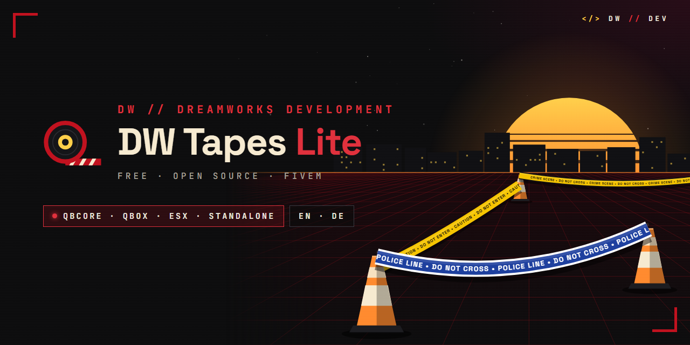

<p align="center"></p>

# DW Tapes Lite – Kostenloses Absperrband

Police Tape, Crime Scene Tape, Caution Tape, Fire Line, EMS Tape, Flatterband (rot/weiß) und Warnband (gelb/schwarz) für FiveM. Kostenlos und Open Source.

🇬🇧 English version: [README.md](README.md)

## Features

- **Item-basiert**: ein Item pro Bandtyp. Benutzen, dann zwei Punkte per Marker am Blickpunkt setzen
- **Vorschau** mit Längenanzeige (`7.3 m / 15.0 m`). Sie wird rot, wenn das Band zu lang ist, du zu weit weg bist oder etwas im Weg ist
- **Boden oder Wand**: Wände, Laternen und Bäume halten das Band direkt. Am Boden wird ein Pylon gesetzt und das Band oben befestigt
- **Aufnehmen per Target** (ox_target / qb-target / qtarget), ohne Target per Taste G
- **Job-Rechte** zum Platzieren und Entfernen pro Bandtyp, optional mit Mindestrang und Dienst-Prüfung
- **Persistenz**: Bänder bleiben über Neustarts erhalten (`tapes.json`)
- **Keine Stream-Dateien**: die Texturen entstehen zur Laufzeit aus `html/tape.html`
- **Sprachen**: Englisch und Deutsch

## Lite oder Vollversion?

| | Lite (kostenlos) | Vollversion |
|---|:---:|:---:|
| 7 Bandtypen, Items, Job-Rechte, Persistenz | ✅ | ✅ |
| Pylone am Boden, Wandbefestigung, Target / Taste G | ✅ | ✅ |
| Seil-Physik: Durchhang, Wind, Peds drücken das Band weg | – | ✅ |
| Spieler heben das Band beim Durchlaufen über den Kopf | – | ✅ |
| Fahrzeuge drücken das Band weg und reißen es | – | ✅ |
| Wind abhängig vom Wetter (Sturm = starkes Flattern) | – | ✅ |
| Rollen mit Restlänge (ox_inventory / qb-inventory) | – | ✅ |
| Ketten-Modus: mehrere Bänder am Stück | – | ✅ |
| 6 Pfosten-Arten, einstellbare Höhe | – | ✅ |
| Bänder an Fahrzeugen befestigen, Wegfahren reißt sie | – | ✅ |
| Bänder mit dem Messer durchschneiden | – | ✅ |
| NPC-Verkehr hält an oder fährt außen herum, NPCs laufen außen herum | – | ✅ |
| Sounds (ohne Audiodateien) | – | ✅ |
| Admin-Menü (ox_lib): Liste, Teleport, Löschen | – | ✅ |
| Discord-Logs | – | ✅ |
| Routing-Bucket-Unterstützung | – | ✅ |
| Absperrständer mit Gurt | – | ✅ |

Vollversion **DW Tapes**: [store.dreamworksrp.de](https://store.dreamworksrp.de/products/tapes)

Fragen und Support: [Discord](https://discord.gg/xEGmNP7vmF) · Fehler und Ideen: [Issues](../../issues)

## Installation

1. Die aktuelle Version unter [Releases](../../releases) herunterladen (oder **Code → Download ZIP**) und den Ordner als **`dw_tapes_lite`** nach `resources/` kopieren
2. In der `server.cfg` (nach Framework, Inventar und Target):
   ```
   ensure dw_tapes_lite
   ```
3. Items anlegen:
   - **ox_inventory** → `install/ox_inventory.lua` in `ox_inventory/data/items.lua` einfügen
   - **qb-core** → `install/qb-core_items.lua` in `qb-core/shared/items.lua` einfügen
   - **ESX Legacy** → `install/esx_items.sql` importieren
   - **Älteres ESX** (Items-Tabelle mit Spalte `limit`) → `install/esx_items_legacy.sql` importieren
4. Die Bilder aus `install/images/` in den Bilder-Ordner deines Inventars kopieren
5. Deutsche Texte: in der `config.lua` `Config.Language = 'de'` setzen
6. Optional die ACE-Rechte:
   ```
   add_ace group.admin dw_tapes.admin allow     # /cleartapes
   add_ace group.admin dw_tapes.command allow   # /tape <typ> ohne Item
   add_ace group.admin dw_tapes.bypass allow    # Job-Rechte und Limit ignorieren
   ```
   `/tape` überspringt beim Platzieren die Job-Prüfung. Wer ein Band gesetzt hat, kann es immer wieder aufnehmen (`Config.OwnerCanRemove`).

## Steuerung

| Taste | Aktion |
|---|---|
| **E** | Punkt setzen |
| **Rechtsklick** | Startpunkt zurücksetzen bzw. abbrechen |
| **Backspace** | Abbrechen |
| Item erneut benutzen | Abbrechen |

## Befehle

- `/tape <typ>` – Band ohne Item platzieren
- `/cleartapes [radius]` – alle Bänder entfernen oder nur die im Umkreis

## Auf die Vollversion wechseln

Item-Namen, ACE-Rechte und die Speicherdatei sind gleich:

1. `dw_tapes_lite` stoppen und entfernen, **nicht** beide gleichzeitig laufen lassen
2. `dw_tapes` installieren
3. `tapes.json` aus `dw_tapes_lite` nach `dw_tapes` kopieren, damit platzierte Bänder erhalten bleiben
4. ox_inventory: in den Items `dw_tapes_lite.useTape` durch `dw_tapes.useTape` ersetzen

## Lizenz

[GNU GPLv3](LICENSE) – frei nutzbar, veränderbar und weitergebbar. Bitte den Copyright-Hinweis behalten und auf dieses Repository verlinken.
