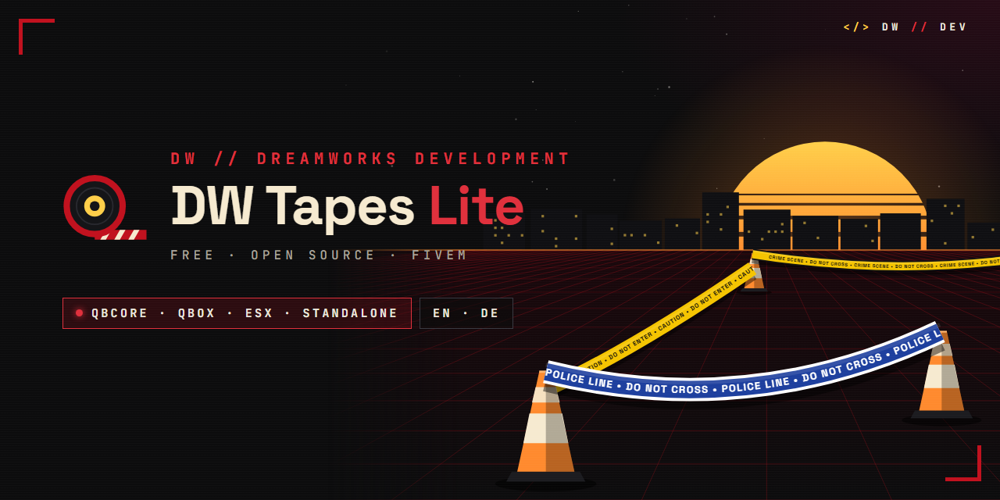
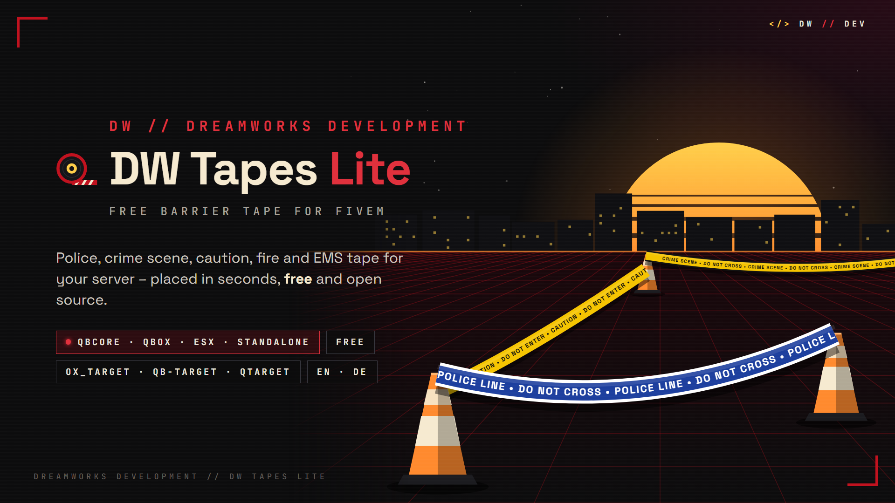
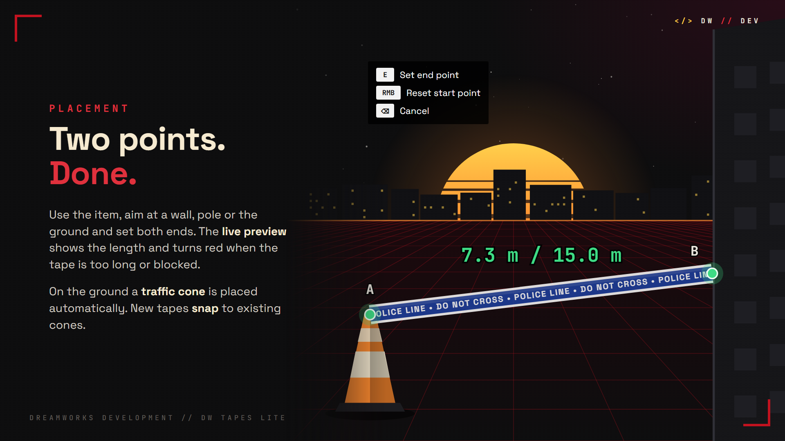
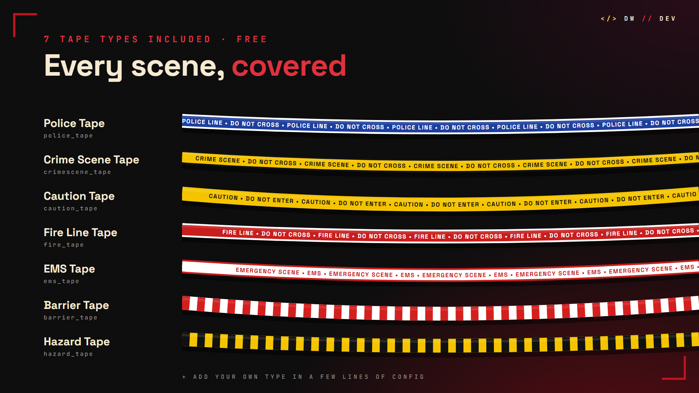
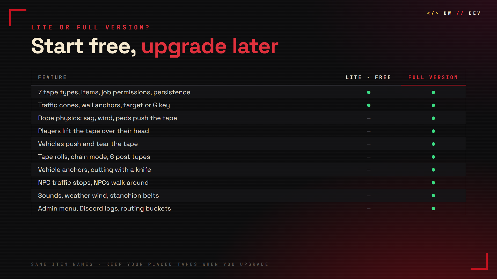

<p align="center">
  
</p>

<p align="center">
  
  
  
  
</p>

# DW Tapes Lite

Free police, crime scene, caution, fire and EMS tape for FiveM – placed in seconds with a live preview, traffic cones on the ground and job permissions.

🇩🇪 Deutsche Version: [README.de.md](README.de.md)

<p align="center"></p>

## Features

- **Item based**: one item per tape type. Use it, then set two points with a marker where you look
- **Live preview** with length display (`7.3 m / 15.0 m`). It turns red when the tape is too long, too far away or blocked
- **Ground or wall**: walls, lamp posts and trees hold the tape directly. On the ground a traffic cone is placed and the tape is tied on top. New tapes snap to existing cones and end points
- **7 tape types**: police, crime scene, caution, fire line, EMS, red/white and yellow/black tape – add your own in a few lines
- **Pick up via target** (ox_target / qb-target / qtarget), without target with the G key
- **Job permissions** for placing and removing, per tape type, with optional minimum grade and on-duty check
- **Persistence**: tapes survive restarts (`tapes.json`)
- **No stream files**: textures are generated at runtime from `html/tape.html`
- **Languages**: English and German

<p align="center"></p>
<p align="center"></p>

## Compatibility

| | |
|---|---|
| Framework | qbx_core, qb-core (current and older versions), ESX Legacy and older ESX (v1 final / 1.2), standalone |
| Inventory | ox_inventory, qb-inventory (old and new item API), ESX default inventory |
| Target | ox_target, qb-target, qtarget, none (G key) |
| Notifications | ox_lib, otherwise QBCore / ESX notify or GTA feed |

Everything is detected automatically (`'auto'`). No required dependencies.

## Installation

1. Download the latest release from the [Releases](../../releases) page, or click **Code → Download ZIP**
2. Put the folder into your `resources/` and name it **`dw_tapes_lite`**
3. Add to your `server.cfg` (after your framework, inventory and target):
   ```
   ensure dw_tapes_lite
   ```
4. Add the items:
   - **ox_inventory** → paste `install/ox_inventory.lua` into `ox_inventory/data/items.lua`
   - **qb-core** → paste `install/qb-core_items.lua` into `qb-core/shared/items.lua`
   - **ESX Legacy** → import `install/esx_items.sql`
   - **Old ESX** (items table with a `limit` column) → import `install/esx_items_legacy.sql`
5. Copy the images from `install/images/` into your inventory's image folder
6. Optional ACE permissions:
   ```
   add_ace group.admin dw_tapes.admin allow     # /cleartapes
   add_ace group.admin dw_tapes.command allow   # /tape <type> without item
   add_ace group.admin dw_tapes.bypass allow    # ignore job permissions and player limit
   ```

> **Note:** the folder must be called `dw_tapes_lite`. With ox_inventory the items call the export `dw_tapes_lite.useTape`.

## Controls

| Key | Action |
|---|---|
| **E** | Set point |
| **Right click** | Reset start point / cancel |
| **Backspace** | Cancel |
| Use the item again | Cancel |

## Commands

- `/tape <type>` – place a tape without an item (ACE `dw_tapes.command`)
- `/cleartapes [radius]` – remove all tapes, or only those within the radius (ACE `dw_tapes.admin`)

## Your own tape type

Add an entry to `Config.Tapes` in `config.lua`. The key is the item name:

```lua
sheriff_tape = {
    label = 'Sheriff Tape', maxLength = 15.0, width = 0.075,
    jobs = { sheriff = 0 },                  -- who may place it (minimum grade per job)
    removeJobs = { 'sheriff', 'police' },    -- who may remove it
    texture = { style = 'text', text = 'SHERIFF  •  DO NOT CROSS', bg = '#7a5a12', fg = '#ffffff', border = '#ffffff' },
},
```

`style = 'stripes'` with `colors = { stripe, background }` creates striped tape.

`jobs` and `removeJobs` accept a list (`{ 'police', 'sheriff' }`, any grade), a map with minimum grades (`{ police = 2 }`) or `nil` (everyone). With `Config.RequireOnDuty = true` players must be on duty.

## Lite or full version?

<p align="center"></p>

The full version **DW Tapes** adds rope physics (sag, wind and weather), players lifting the tape over their head, vehicles tearing it, tape rolls, chain mode, 6 post types, vehicle anchors, cutting with a knife, NPC traffic that stops, sounds, stanchion belts, an admin menu, Discord logs and routing bucket support.

👉 **Full version:** [store.dreamworksrp.de](https://store.dreamworksrp.de)

### Upgrading

Item names, ACE permissions and the save file are the same:

1. Stop and remove `dw_tapes_lite` – do **not** run both at the same time
2. Install `dw_tapes`
3. Copy `tapes.json` from `dw_tapes_lite` into `dw_tapes` to keep placed tapes
4. ox_inventory: replace `dw_tapes_lite.useTape` with `dw_tapes.useTape` in your items

## Support

- Bugs and ideas: [Issues](../../issues)
- Discord: [discord.gg/xEGmNP7vmF](https://discord.gg/xEGmNP7vmF)

## License

Free to use and modify on your own servers. Selling it or re-uploading it elsewhere is not allowed. See [LICENSE](LICENSE).

<sub>Dreamworks Development // DW Tapes Lite</sub>
